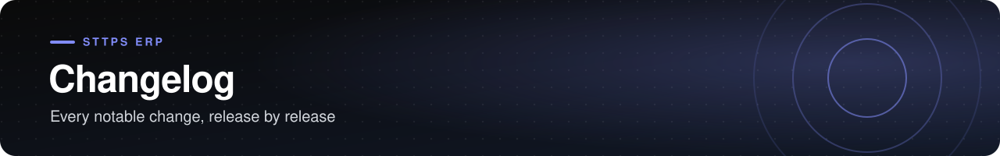

 

<strong>Every notable change to this project, newest first.</strong>

---

> [!NOTE]
> The format follows [Keep a Changelog](https://keepachangelog.com/en/1.1.0/) and the project uses [Semantic Versioning](https://semver.org/spec/v2.0.0.html). Each version links to its full comparison at the bottom of this page, and to its [release notes](https://github.com/saadmaz/STTPS-ERP/releases).

## [Unreleased]

### Added

- Product blueprint (`docs/BLUEPRINT.md`) and a new phase-based implementation plan covering every blueprint section, replacing the Prisma-era plan.

## [0.4.1] - 2026-11-18

### Changed

- Dependency updates in web and admin: Next.js and PostCSS, sonner 2, @types/node, follow-redirects and postcss-selector-parser.

## [0.4.0] - 2026-11-17

### Added

- ESLint in `api`, `web` and `admin` (TypeScript rules, plus Next.js core web vitals for the two front ends), with a `lint` script in each app and a lint step in CI. `any` types are warnings while modules are ported.
- Cloudflare hosting: `web` and `admin` on Workers through OpenNext, and `api` in a Cloudflare Container behind a Worker, with production and development environments. Production deploys switch on with the `CLOUDFLARE_ENABLED` variable.
- One Deploy workflow that deploys only the apps that changed, in order: api, web, admin.

## [0.3.0] - 2026-11-17

### Removed

- Unused imports and variables flagged by the new lint setup.
- Unused dependencies in `web` (13) and `admin` (11), including ESLint, which was installed but never configured, and the `lint` scripts that could not run.
- Shared-hosting deployment: the SSH deploy workflow, Passenger start files for `web` and `admin`, the server-side deploy script, Next.js standalone output and the `dotenv` dependency it needed. Hosting moves to Cloudflare.

## [0.2.3] - 2026-11-17

### Changed

- Contributing, Security Policy, Code of Conduct, License and Changelog redesigned with branded headers, navigation, tables, diagrams and callouts; the licence is now LICENSE.md.

## [0.2.2] - 2026-11-17

### Changed

- README shows the development environment as awaiting host setup until development deploys are enabled.

## [0.2.1] - 2026-11-17

### Changed

- Redesigned README with a brand banner, live release, CI and deployment badges, action buttons, feature grid, diagrams and collapsible panels.
- Navigation bars and callouts across the contributing, security, conduct and documentation pages.

## [0.2.0] - 2026-11-17

### Added

- Development and production environments: `develop` deploys to development and `main` to production, through one Deploy workflow and GitHub Environments with per-environment settings.

## [0.1.0] - 2026-11-16

First pre-production release. The platform and identity layer is complete; domain modules are being ported to Firestore.

### Added

- **api:** NestJS API with JWT authentication, multi-tenancy, companies, users, roles and permissions, and admin endpoints on Cloud Firestore; Swagger documentation; Firestore seeding script.
- **web:** staff application with dashboard and screens for finance, inventory, procurement, sales and CRM, manufacturing, HR, EAM, FSM, quality, EHS, projects, analytics and settings.
- **admin:** platform admin console for tenants, companies, users and roles.
- Firestore security rules and composite indexes.
- Independent deploy pipelines per app, building on GitHub Actions and shipping standalone artefacts to Passenger.
- Continuous integration on every push and pull request: type check and production build for every app.
- Product, technical, flow, schema, design and implementation documentation under `docs/`.
- Project governance: proprietary licence, security policy, contribution guidelines, code of conduct, issue forms, pull request template, CODEOWNERS and Dependabot.
- Standard documentation layout shared by every STTPS repository: architecture, configuration, deployment, decision records (ADRs) and release and rollback runbooks, indexed in `docs/README.md`.

### Changed

- API persistence migrated from Prisma and PostgreSQL to Cloud Firestore to suit the hosting platform.

### Security

- Next.js upgraded from 15.1.4 to 15.5.29 in `web` and `admin`, closing critical advisories, and semver-compatible dependency fixes applied across all apps.
- Server access details removed from the deployment guide.

[Unreleased]: https://github.com/saadmaz/STTPS-ERP/compare/v0.4.1...HEAD
[0.4.1]: https://github.com/saadmaz/STTPS-ERP/compare/v0.4.0...v0.4.1
[0.4.0]: https://github.com/saadmaz/STTPS-ERP/compare/v0.3.0...v0.4.0
[0.3.0]: https://github.com/saadmaz/STTPS-ERP/compare/v0.2.3...v0.3.0
[0.2.3]: https://github.com/saadmaz/STTPS-ERP/compare/v0.2.2...v0.2.3
[0.2.2]: https://github.com/saadmaz/STTPS-ERP/compare/v0.2.1...v0.2.2
[0.2.1]: https://github.com/saadmaz/STTPS-ERP/compare/v0.2.0...v0.2.1
[0.2.0]: https://github.com/saadmaz/STTPS-ERP/compare/v0.1.0...v0.2.0
[0.1.0]: https://github.com/saadmaz/STTPS-ERP/releases/tag/v0.1.0
