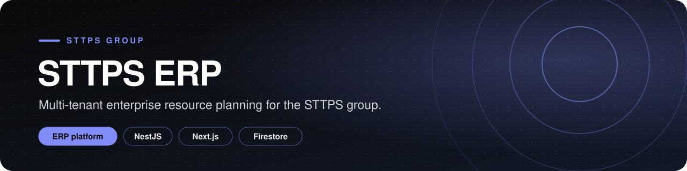
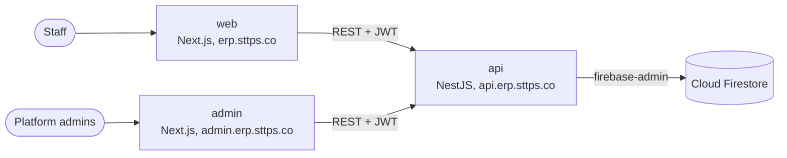
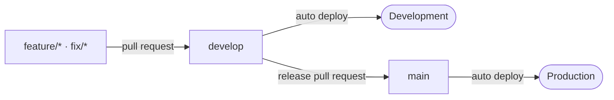

<a id="readme-top"></a>

<div align="center">



<br/><br/>

<p><strong>One platform for identity, companies, finance, inventory, procurement, sales, manufacturing, HR, assets, field service, quality, EHS and projects across every STTPS business.</strong></p>

<a href="https://github.com/saadmaz/STTPS-ERP/releases"></a>
<a href="https://github.com/saadmaz/STTPS-ERP/actions/workflows/ci.yml"></a>
<a href="https://github.com/saadmaz/STTPS-ERP/deployments"></a>
<a href="https://github.com/saadmaz/STTPS-ERP/commits/develop"></a>


<br/><br/>

<a href="https://erp.sttps.co"></a>
<a href="docs/README.md"></a>
<a href="https://github.com/saadmaz/STTPS-ERP/issues/new?template=bug_report.yml"></a>
<a href="https://github.com/saadmaz/STTPS-ERP/issues/new?template=feature_request.yml"></a>

<br/><br/>

<a href="#about">About</a> ·
<a href="#features">Features</a> ·
<a href="#architecture">Architecture</a> ·
<a href="#getting-started">Getting started</a> ·
<a href="#deployment">Deployment</a> ·
<a href="#documentation">Documentation</a> ·
<a href="#contributing">Contributing</a>

</div>

---

<details>
<summary><strong>Table of contents</strong></summary>

1. [About](#about)
2. [Features](#features)
3. [Architecture](#architecture)
4. [Tech stack](#tech-stack)
5. [Getting started](#getting-started)
6. [Configuration](#configuration)
7. [Project structure](#project-structure)
8. [Quality checks](#quality-checks)
9. [Deployment](#deployment)
10. [Documentation](#documentation)
11. [Releases and versioning](#releases-and-versioning)
12. [Contributing](#contributing)
13. [Security](#security)
14. [License](#license)

</details>

## About

STTPS ERP is the operating platform for the STTPS group of companies. It is multi-tenant from the ground up: each tenant holds one or more companies, and every user, role and permission is scoped to them.

| | |
| --- | --- |
| **Organisation** | STTPS (Pvt) Ltd |
| **Status** | Pre-production: platform layer built, domain modules being ported |
| **Production** | [erp.sttps.co](https://erp.sttps.co) |
| **Admin console** | [admin.erp.sttps.co](https://admin.erp.sttps.co) |
| **API** | `api.erp.sttps.co` |
| **Contact** | [hello@sttps.co](mailto:hello@sttps.co) |
| **Maintainer** | [Saad Mazhar](https://github.com/saadmaz) |

<p align="right"><a href="#readme-top">Back to top ↑</a></p>

## Features

<table>
<tr><td width="50%" valign="top"><strong>Multi-tenancy</strong><br/>tenants, companies within them, and per-company scoping of every user, role and permission.</td><td width="50%" valign="top"><strong>Identity and access</strong><br/>short-lived JWT access tokens with refresh sessions stored in Firestore, roles and fine-grained permissions enforced by API guards.</td></tr>
<tr><td width="50%" valign="top"><strong>Admin console</strong><br/>platform administration of tenants, companies, users and roles.</td><td width="50%" valign="top"><strong>Domain modules</strong><br/>finance, inventory, procurement, sales and CRM, manufacturing, HR, enterprise asset management, field service, quality, EHS and projects, with screens in the staff application and APIs being ported to Firestore.</td></tr>
<tr><td width="50%" valign="top"><strong>API documentation</strong><br/>Swagger, generated from the NestJS controllers.</td><td width="50%" valign="top"><strong>Independent delivery</strong><br/>each application builds, deploys and rolls back on its own.</td></tr>
</table>

<p align="right"><a href="#readme-top">Back to top ↑</a></p>

## Architecture

Three standalone applications: a NestJS API on Cloud Firestore, a Next.js staff application and a Next.js admin console. Each has its own lockfile and deploy pipeline, so a failure in one never blocks the others.



> [!TIP]
> The full design, with every component and data flow, is in [docs/ARCHITECTURE.md](docs/ARCHITECTURE.md). Significant decisions are recorded as [architecture decision records](docs/adr/README.md).

<p align="right"><a href="#readme-top">Back to top ↑</a></p>

## Tech stack

<p>


</p>

<details>
<summary><strong>Full stack breakdown</strong></summary>

| App | Technology | Local port |
| --- | --- | --- |
| `web/` | Next.js 15 (App Router), React 19, TanStack Query, Zustand, Tailwind CSS | 3000 |
| `admin/` | Next.js 15 (App Router), React 19, Tailwind CSS | 3002 |
| `api/` | NestJS 10, Passport JWT, Swagger, `firebase-admin` (Firestore) | 3001 |

All three run on Node.js 22 under Phusion Passenger on cPanel hosting.

</details>

<p align="right"><a href="#readme-top">Back to top ↑</a></p>

## Getting started

### Prerequisites

- Node.js 22
- npm 10 or later
- A Firebase project with Firestore in Native mode, and a service account for the API

### Install and run

Each app is installed and run on its own:

```sh
git clone https://github.com/saadmaz/STTPS-ERP.git
cd STTPS-ERP

cd api   && npm ci && cp .env.example .env && npm run dev    # http://localhost:3001
cd ../web   && npm ci && cp .env.example .env.local && npm run dev # http://localhost:3000
cd ../admin && npm ci && cp .env.example .env.local && npm run dev # http://localhost:3002
```

Fill in each file from its `.env.example`. Seed a development Firestore project with `npm run seed:firestore` in `api/`.

<details>
<summary><strong>All scripts</strong></summary>

| Command | `api` | `web` / `admin` |
| --- | --- | --- |
| `npm run dev` | NestJS in watch mode | Next.js dev server |
| `npm run build` | Compile to `dist/` | Standalone production build |
| `npm start` | Run the compiled API | Run the production server (`start.mjs`) |
| `npm run typecheck` | `tsc --noEmit` | `tsc --noEmit` |
| `npm run seed:firestore` | Seed Firestore with platform data | |

</details>

<p align="right"><a href="#readme-top">Back to top ↑</a></p>

## Configuration

`api` reads its Firebase service account, JWT secret and CORS origins from `api/.env`; `web` and `admin` need only `NEXT_PUBLIC_API_URL`, which is compiled in at build time.

<details>
<summary><strong>Environment variables</strong></summary>

| Variable | Purpose |
| --- | --- |
| `FIREBASE_PROJECT_ID`, `FIREBASE_CLIENT_EMAIL`, `FIREBASE_PRIVATE_KEY` | Service account for Firestore. **Secret.** The private key is stored on one line with literal `\n` sequences |
| `FIRESTORE_EMULATOR_HOST` | Development and CI only; never set in production |
| `JWT_SECRET` | Signing secret for access tokens, at least 32 random characters (`openssl rand -base64 48`). **Secret** |
| `JWT_EXPIRES_IN` | Access token lifetime, default `15m` |
| `PORT` | Listening port, default `3001` |
| `NODE_ENV` | `development` or `production` |
| `FRONTEND_URL`, `ADMIN_URL` | Allowed CORS origins; must match the deployed `web` and `admin` origins exactly |
| `DATABASE_URL` | Inert placeholder kept so `prisma generate` succeeds; not connected |

Where each value is set, and which are secret: [docs/CONFIGURATION.md](docs/CONFIGURATION.md).

</details>


<p align="right"><a href="#readme-top">Back to top ↑</a></p>

## Project structure

<details>
<summary><strong>Repository layout</strong></summary>

```
.
├── .github/workflows/     # CI, plus one deploy workflow per app
├── api/                   # NestJS API: auth, tenant, company, user, admin and domain modules
│   ├── prisma/            # Reference data model for modules not yet ported (not connected)
│   ├── scripts/           # Firestore seeding
│   └── deploy.sh          # Server-side deploy script
├── web/                   # Staff application: dashboard and every domain module
├── admin/                 # Platform admin console: tenants, companies, users and roles
├── docs/                  # Architecture, configuration, deployment, ADRs, runbooks and product docs
├── firestore.rules        # Firestore security rules
└── firestore.indexes.json # Composite indexes required by the admin console
```

</details>

<p align="right"><a href="#readme-top">Back to top ↑</a></p>

## Quality checks

Every pull request into `develop` or `main` runs the [CI workflow](.github/workflows/ci.yml): a type check and production build for `api`, `web` and `admin`. Pull requests merge only when CI is green.

```sh
npm run typecheck && npm run build  # in each of api/, web/ and admin/
```

> [!IMPORTANT]
> Run the same checks locally before opening a pull request. They are the exact commands CI runs.

<p align="right"><a href="#readme-top">Back to top ↑</a></p>

## Deployment

| Environment | Branch | URL | Status |
| --- | --- | --- | --- |
| Development | `develop` | [dev.erp.sttps.co](https://dev.erp.sttps.co) |  |
| Production | `main` | [erp.sttps.co](https://erp.sttps.co) |  |



The Deploy workflow builds on GitHub Actions and ships each changed app over SSH to Passenger. Environments, setup, secrets and post-deployment checks are in [docs/DEPLOYMENT.md](docs/DEPLOYMENT.md).

> [!TIP]
> To ship or undo a release, follow the [release](docs/runbooks/release.md) and [rollback](docs/runbooks/rollback.md) runbooks.

<p align="right"><a href="#readme-top">Back to top ↑</a></p>

## Documentation

Every STTPS repository uses the same documentation layout.

| Document | Covers |
| --- | --- |
| [Documentation index](docs/README.md) | Every document in this repository |
| [Architecture](docs/ARCHITECTURE.md) | How the system is built and how data flows |
| [Configuration](docs/CONFIGURATION.md) | Environment variables and configuration files |
| [Deployment](docs/DEPLOYMENT.md) | Environments, hosting, pipeline and first-time setup |
| [Decision records](docs/adr/README.md) | Why the system is built the way it is |
| [Runbooks](docs/runbooks/README.md) | Release and rollback procedures |

<p align="right"><a href="#readme-top">Back to top ↑</a></p>

## Releases and versioning

[](https://github.com/saadmaz/STTPS-ERP/releases)

The project follows [Semantic Versioning](https://semver.org). Versions below `1.0.0` are pre-production. Every release is tagged `vX.Y.Z`, published on the [Releases](https://github.com/saadmaz/STTPS-ERP/releases) page with its notes, and recorded in [CHANGELOG.md](CHANGELOG.md). The procedure is in [docs/runbooks/release.md](docs/runbooks/release.md).

<p align="right"><a href="#readme-top">Back to top ↑</a></p>

## Contributing

| Step | |
| --- | --- |
| 1 | Branch from `develop` using a type prefix (`feat/`, `fix/`, `docs/`, ...) |
| 2 | Commit with [Conventional Commits](https://www.conventionalcommits.org) |
| 3 | Open a pull request into `develop` and complete the checklist |
| 4 | Squash and merge once CI is green and the change is reviewed |

The full guide is in [CONTRIBUTING.md](CONTRIBUTING.md). Everyone taking part follows the [Code of Conduct](CODE_OF_CONDUCT.md).

<p align="right"><a href="#readme-top">Back to top ↑</a></p>

## Security

> [!IMPORTANT]
> Never report a vulnerability in a public issue. Follow [SECURITY.md](SECURITY.md) to report it privately; you will hear back within three business days.

<p align="right"><a href="#readme-top">Back to top ↑</a></p>

## License

Copyright © 2026 STTPS (Pvt) Ltd. All rights reserved.

This is proprietary software. The source is publicly visible, but no permission is granted to use, copy, modify or distribute it without prior written consent. See [LICENSE](LICENSE).

<div align="center">
<br/>
<sub>Built and maintained by the STTPS team · Part of the <a href="https://sttps.co">STTPS group</a></sub>
</div>
