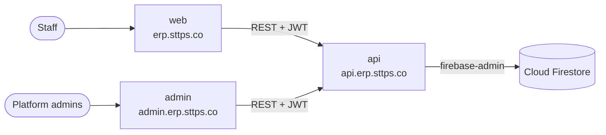

<div align="center">

# STTPS ERP

**Multi-tenant enterprise resource planning for the STTPS group.**

One platform for identity, companies, finance, inventory, procurement, sales, manufacturing, HR, assets, field service, quality, EHS and projects across every STTPS business.

[](https://github.com/saadmaz/STTPS-ERP/actions/workflows/deploy-web.yml)
[](https://github.com/saadmaz/STTPS-ERP/actions/workflows/deploy-admin.yml)
[](https://github.com/saadmaz/STTPS-ERP/actions/workflows/ci.yml)


[Deployment guide](docs/DEPLOYMENT.md) · [Product requirements](docs/PRD.md) · [Architecture plan](docs/ARCHITECTURE-PLAN.md)

</div>

---

## Contents

- [About](#about)
- [Status](#status)
- [Architecture](#architecture)
- [Tech stack](#tech-stack)
- [Getting started](#getting-started)
- [Project structure](#project-structure)
- [Quality checks](#quality-checks)
- [Deployment](#deployment)
- [Documentation](#documentation)
- [Releases and versioning](#releases-and-versioning)
- [Contributing](#contributing)
- [Security](#security)
- [License](#license)

## About

STTPS ERP is the operating platform for the STTPS group of companies. It is multi-tenant from the ground up: each tenant holds one or more companies, and every user, role and permission is scoped to them.

| | |
| --- | --- |
| **Organisation** | STTPS (Pvt) Ltd |
| **Application** | [erp.sttps.co](https://erp.sttps.co) |
| **Admin console** | [admin.erp.sttps.co](https://admin.erp.sttps.co) |
| **API** | `api.erp.sttps.co` |
| **Contact** | [hello@sttps.co](mailto:hello@sttps.co) |
| **Maintainer** | [Saad Mazhar](https://github.com/saadmaz) |

## Status

| Area | State |
| --- | --- |
| Platform and identity: authentication, tenants, companies, users, roles and permissions, admin console | Built on Firestore |
| `web` and `admin` | Live |
| `api` | Provisioned; goes live once its Firebase service account is configured ([prerequisites](docs/DEPLOYMENT.md#2-prerequisites-before-the-api-goes-live)) |
| Domain modules: finance, inventory, procurement, sales and CRM, manufacturing, HR, EAM, FSM, quality, EHS, projects | Screens built; API modules being ported to Firestore (Phase 2) |

Until a domain module is ported, its screens in `web` show empty states. That is expected, not a fault.

## Architecture



Three independent, standalone apps with no shared packages or monorepo tooling. Each has its own `package.json`, lockfile and deploy pipeline, so a broken build in one never blocks the others. The long-term target architecture is described in [docs/ARCHITECTURE-PLAN.md](docs/ARCHITECTURE-PLAN.md); treat it as a roadmap, not as-built documentation.

## Tech stack

| App | Technology | Local port |
| --- | --- | --- |
| `web/` | Next.js 15 (App Router), React 19, TanStack Query, Zustand, Tailwind CSS | 3000 |
| `admin/` | Next.js 15 (App Router), React 19, Tailwind CSS | 3002 |
| `api/` | NestJS 10, Passport JWT, Swagger, `firebase-admin` (Firestore) | 3001 |

All three run on Node.js 22 under Phusion Passenger on cPanel hosting.

## Getting started

### Prerequisites

- Node.js 22
- npm 10 or later
- A Firebase project with Firestore in Native mode, and a service account for the API

### Install and run

Each app is installed and run on its own:

```sh
git clone https://github.com/saadmaz/STTPS-ERP.git
cd STTPS-ERP

cd api   && npm ci && cp .env.example .env && npm run dev    # http://localhost:3001
cd ../web   && npm ci && cp .env.example .env && npm run dev # http://localhost:3000
cd ../admin && npm ci && cp .env.example .env && npm run dev # http://localhost:3002
```

Fill in each `.env` from its `.env.example`. Seed a development Firestore project with `npm run seed:firestore` in `api/`.

### Scripts

| Command | `api` | `web` / `admin` |
| --- | --- | --- |
| `npm run dev` | NestJS in watch mode | Next.js dev server |
| `npm run build` | Compile to `dist/` | Standalone production build |
| `npm start` | Run the compiled API | Run the production server (`start.mjs`) |
| `npm run type-check` | `tsc --noEmit` | `tsc --noEmit` |
| `npm run seed:firestore` | Seed Firestore with platform data | |

## Project structure

```
.
├── .github/workflows/     # CI, plus one deploy workflow per app
├── api/                   # NestJS API: auth, tenant, company, user, admin and domain modules
│   ├── prisma/            # Reference data model for modules not yet ported (not connected)
│   ├── scripts/           # Firestore seeding
│   └── deploy.sh          # Server-side deploy script
├── web/                   # Staff application: dashboard and every domain module
├── admin/                 # Platform admin console: tenants, companies, users and roles
├── docs/                  # Requirements, design, schema, plans and deployment guide
├── firestore.rules        # Firestore security rules
└── firestore.indexes.json # Composite indexes required by the admin console
```

## Quality checks

Pull requests into `main` run the [CI workflow](.github/workflows/ci.yml): a type check and production build for `api`, `web` and `admin`. Run the same checks in each app before opening a pull request:

```sh
npm run type-check && npm run build
```

## Deployment

Each app deploys independently on push to `main` when its own folder changes: [`deploy-web.yml`](.github/workflows/deploy-web.yml), [`deploy-admin.yml`](.github/workflows/deploy-admin.yml) and [`deploy-api.yml`](.github/workflows/deploy-api.yml). The build runs on GitHub Actions (the host is too constrained to build reliably), and the artefact is shipped over SSH and restarted under Passenger. The three workflows share a concurrency group so they never compete for the host.

Server access details are held in GitHub Actions secrets. First-time setup, environment variables, Firestore rules and indexes, and rollback are covered in [docs/DEPLOYMENT.md](docs/DEPLOYMENT.md).

## Documentation

| Document | Covers |
| --- | --- |
| [DEPLOYMENT.md](docs/DEPLOYMENT.md) | As-built architecture, hosting, prerequisites and deploy process |
| [PRD.md](docs/PRD.md) | Product requirements |
| [TRD.md](docs/TRD.md) | Technical requirements |
| [App-Flow.md](docs/App-Flow.md) | User journeys and application flow |
| [Backend-Schema.md](docs/Backend-Schema.md) | Data model |
| [UI-UX-Design-Brief.md](docs/UI-UX-Design-Brief.md) | Design brief |
| [Implementation-Plan.md](docs/Implementation-Plan.md) | Phased delivery plan |
| [ARCHITECTURE-PLAN.md](docs/ARCHITECTURE-PLAN.md) | Long-term architecture and roadmap |

## Releases and versioning

The project follows [Semantic Versioning](https://semver.org). Releases are tagged `vX.Y.Z` and published on the [Releases](https://github.com/saadmaz/STTPS-ERP/releases) page; versions below `1.0.0` are pre-production. Notable changes are recorded in [CHANGELOG.md](CHANGELOG.md).

## Contributing

Read [CONTRIBUTING.md](CONTRIBUTING.md) for the branching model, commit conventions and pull request checklist. All participants are expected to follow the [Code of Conduct](CODE_OF_CONDUCT.md).

## Security

Please do not report security issues in public issues. See [SECURITY.md](SECURITY.md) for how to report a vulnerability privately.

## License

Copyright © 2026 STTPS (Pvt) Ltd. All rights reserved.

This is proprietary software. No permission is granted to use, copy, modify or distribute it without prior written consent. See [LICENSE](LICENSE).
