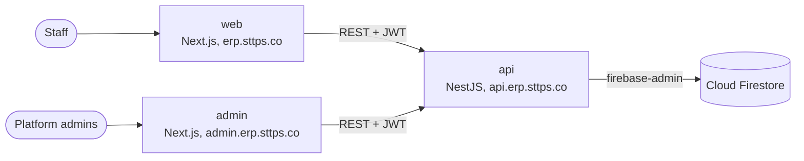

# Architecture

<!-- nav -->
<a href="../README.md">Project README</a> · <a href="README.md">Documentation index</a>

> How STTPS ERP is built today. The long-term target is in [ARCHITECTURE-PLAN.md](ARCHITECTURE-PLAN.md). Part of the [project documentation](README.md).

## Overview

Three standalone applications with no shared packages. Each has its own `package.json`, lockfile and build, so a broken build in one never blocks the others.

| App | Technology | Production | Local port |
| --- | --- | --- | --- |
| `web/` | Next.js 15 (App Router), React 19, TanStack Query, Zustand | `erp.sttps.co` | 3000 |
| `admin/` | Next.js 15 (App Router), React 19 | `admin.erp.sttps.co` | 3002 |
| `api/` | NestJS 10, Passport JWT, Swagger, `firebase-admin` | `api.erp.sttps.co` | 3001 |

## Multi-tenancy

Every record belongs to a tenant, and most to a company within it. Users, roles and permissions are scoped the same way, and the API reads the active company from the `x-company-id` request header on every call.

## Authentication

The API issues short-lived JWT access tokens (`JWT_EXPIRES_IN`, 15 minutes by default) and opaque refresh tokens stored in the Firestore `sessions` collection.

## Module status

The platform and identity layer (auth, tenants, companies, users, roles and permissions, the admin console) runs on Firestore. The domain modules (finance, inventory, procurement, sales and CRM, manufacturing, HR, EAM, FSM, quality, EHS and projects) have screens in `web` and are being ported in the API; until then they are disabled in `api/src/app.module.ts`, and `api/prisma/schema.prisma` is kept as their reference data model.

Significant decisions are recorded in [adr/](adr/README.md).
