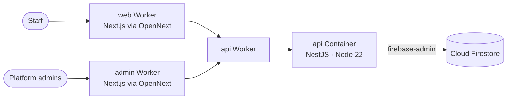

# Deployment

<!-- nav -->

<sub><a href="../README.md">Project README</a> · <a href="README.md">Documentation index</a></sub>

> How STTPS ERP reaches production. Part of the [project documentation](README.md).

> [!IMPORTANT]
> The ERP runs on **Cloudflare** and is not in production yet. Production deploys switch on with the `CLOUDFLARE_ENABLED` repository variable, so nothing deploys until you are ready.

## Environments

| Environment   | Branch    | Staff app | Admin console | API |
| ------------- | --------- | --------- | ------------- | --- |
| `development` | `develop` | [dev.erp.sttps.co](https://dev.erp.sttps.co) | [dev.admin.erp.sttps.co](https://dev.admin.erp.sttps.co) | `dev.api.erp.sttps.co` |
| `production`  | `main`    | [erp.sttps.co](https://erp.sttps.co) | [admin.erp.sttps.co](https://admin.erp.sttps.co) | `api.erp.sttps.co` |

Each is a GitHub Environment with its own variables and secrets. Production accepts deployments from `main` only; development from `develop` only.

### Promotion

1. Feature branches merge into `develop` and deploy to development (once `DEVELOPMENT_ENABLED` is `true`).
2. A release pull request from `develop` into `main` (see [runbooks/release.md](runbooks/release.md)) promotes the change.
3. Merging it deploys to production (once `CLOUDFLARE_ENABLED` is `true`).

## How it runs



| App | Cloudflare | Configuration |
| --- | --- | --- |
| `web` | Worker built with [`@opennextjs/cloudflare`](https://opennext.js.org/cloudflare) | `web/wrangler.jsonc`, `web/open-next.config.ts` |
| `admin` | Worker built with OpenNext | `admin/wrangler.jsonc`, `admin/open-next.config.ts` |
| `api` | Worker in front of a Cloudflare Container running the NestJS server | `api/wrangler.jsonc`, `api/Dockerfile`, `api/worker/index.ts` |

## How a deploy works

[`deploy.yml`](../.github/workflows/deploy.yml) runs on every push to `main` or `develop`. It detects which app folders changed and deploys only those, in order:

1. **api:** build, then `wrangler deploy`, which builds the container image, publishes the Worker and uploads the runtime secrets.
2. **web:** `opennextjs-cloudflare build` with the environment's `NEXT_PUBLIC_API_URL`, then `opennextjs-cloudflare deploy`.
3. **admin:** the same as `web`.

## First-time setup

1. **Cloudflare API token.** Create a token with the *Edit Cloudflare Workers* template plus *Containers: Edit*, and store it as the `CLOUDFLARE_API_TOKEN` repository secret. `CLOUDFLARE_ACCOUNT_ID` is already set as a repository variable.
2. **API secrets.** Add `FIREBASE_PROJECT_ID`, `FIREBASE_CLIENT_EMAIL`, `FIREBASE_PRIVATE_KEY` and `JWT_SECRET` (at least 32 random characters: `openssl rand -base64 48`) as repository secrets.
3. **API URLs.** `WEB_NEXT_PUBLIC_API_URL` and `ADMIN_NEXT_PUBLIC_API_URL` are already repository secrets; set them to `https://api.erp.sttps.co` for production (the apps add `/api/v1` themselves); override them per environment for development.
4. **Switch on deploys.** Set the repository variable `CLOUDFLARE_ENABLED` to `true`, then run the **Deploy** workflow on `main`.
5. **Domains.** Add `erp.sttps.co`, `admin.erp.sttps.co` and `api.erp.sttps.co` as custom domains on the `sttps-erp-web`, `sttps-erp-admin` and `sttps-erp-api` Workers. Remove the old DNS records that pointed these names at the previous host.
6. **Firestore.** Deploy rules and indexes once: `firebase deploy --only firestore:rules,firestore:indexes`. Seed a new project with `npm run seed:firestore` in `api/`.
7. Repeat steps 2 to 5 for development with the `dev.` names, then set `DEVELOPMENT_ENABLED` to `true`.

The API's non-secret settings (`JWT_EXPIRES_IN`, `FRONTEND_URL`, `ADMIN_URL`) are in `api/wrangler.jsonc`, per environment. Every variable is described in [CONFIGURATION.md](CONFIGURATION.md).

## Run on Cloudflare's runtime locally

```sh
cd web && npm run cf:preview     # or admin
cd api && npm run build && docker build -t erp-api . && docker run -p 8080:8080 --env-file .env erp-api
```

## Post-deployment checks

1. `https://erp.sttps.co/` redirects to `/login`, and `https://admin.erp.sttps.co` loads.
2. `https://api.erp.sttps.co/api/v1/auth/me` returns `401` without a token, proving the API is up and guarding routes.
3. A user can sign in to `web` and an administrator to `admin`.
