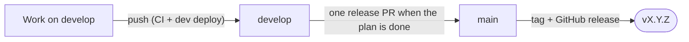

# Implementation Plan — STTPS ERP

<!-- nav -->
<a href="../README.md">Project README</a> · <a href="README.md">Documentation index</a>

> How the full [product blueprint](BLUEPRINT.md) gets built, phase by phase, starting from the code as it stands.
> This plan replaces the earlier Prisma/PostgreSQL plan, which [ADR-0002](adr/0002-cloud-firestore-instead-of-postgresql.md) made obsolete.

| | |
| --- | --- |
| **Baseline** | v0.4.1 (November 2026) |
| **Scope** | Every section of [BLUEPRINT.md](BLUEPRINT.md) |
| **Stack** | NestJS 10 API on Cloud Firestore · Next.js 15 `web` and `admin` · Cloudflare Workers and Containers |
| **Target** | v1.0.0 once Phase 7 is complete |

---

## Contents

1. [Where we start](#1-where-we-start)
2. [How work flows](#2-how-work-flows)
3. [Engineering rules for every phase](#3-engineering-rules-for-every-phase)
4. [Phase overview](#4-phase-overview)
5. [Phase 0 — Platform foundation](#phase-0--platform-foundation)
6. [Phase 1 — Core operations](#phase-1--core-operations)
7. [Phase 2 — Financial core](#phase-2--financial-core)
8. [Phase 3 — Workforce](#phase-3--workforce)
9. [Phase 4 — Operations](#phase-4--operations)
10. [Phase 5 — Advanced operations](#phase-5--advanced-operations)
11. [Phase 6 — Intelligence and integrations](#phase-6--intelligence-and-integrations)
12. [Phase 7 — Hardening and 1.0](#phase-7--hardening-and-10)
13. [Blueprint coverage map](#13-blueprint-coverage-map)
14. [Risks](#14-risks)

---

## 1. Where we start

| Area | State at v0.4.1 |
| --- | --- |
| Identity, tenants, companies, users, roles, permissions | **Live on Firestore.** JWT plus refresh sessions, `RequirePermissionGuard` on every route, admin console. |
| Finance (GL, AR, AP, bank, fixed assets, budgets, reports), inventory, procurement, CRM, sales, manufacturing/MRP, HR/payroll, EAM, field service, quality, EHS, projects | **Written but switched off.** About 4,300 lines of services and 269 endpoints still call Prisma, so `app.module.ts` does not load them. `api/prisma/schema.prisma` (100 models) is the reference data model. `web` has screens for all of them, but the screens have no live API behind them. |
| Workflow/approval engine, automation, notifications, documents, search, custom fields, saved views, support desk, customer portal, POS, logistics/fleet, marketing, calendar, BI builders, AI, API platform | **Not started.** |
| Tests | None. CI runs lint, type check and build for each app. |

Two pieces of work therefore run side by side: **porting** the existing modules to Firestore and **extending** them to the blueprint's scope. Every port is done once, directly to the blueprint version, never to a straight copy that is then rewritten.

## 2. How work flows

- Commits go straight to `develop` with conventional messages (`feat(crm): …`, `fix(gl): …`). CI runs on every push. Development deploys once `DEVELOPMENT_ENABLED` is on.
- `CHANGELOG.md` collects every user-facing change under `Unreleased` as it lands.
- **No release per commit or per phase.** When the plan is complete, one pull request from `develop` into `main` is merged and released following [runbooks/release.md](runbooks/release.md). Any phase boundary can still be cut as an intermediate release if production needs it earlier; the phase table suggests the version each one would take.
- Each phase ends with a short status update in this file (the checkboxes below) rather than a release.

## 3. Engineering rules for every phase

These come from blueprint §3, §33, §39 and §40 and apply to every module.

**Data on Firestore**

- One top-level collection per entity, named in `COLLECTIONS`, with `tenantId` and `companyId` on every document. All reads go through the shared repository (Phase 0), which applies tenant/company scope, so no query can leave it out.
- Money is stored as integer minor units (cents) plus a currency code, never floats. Quantities use a fixed scale (thousandths).
- Postings are append-only: journal lines, stock movements, payments and payslips are new documents written in a Firestore transaction. Balances are maintained projections, recomputable from the ledger. Corrections are reversals, never edits (§10 finance controls).
- Document numbers (`INV-2026-000123`) come from transactional per-company counters.
- Firestore limits shape the design. Transactions are capped at 500 writes, so large jobs such as payroll runs and MRP are chunked through background jobs. Cross-entity reports read pre-aggregated summary documents. Heavy analytics go to a BigQuery export (Phase 6).
- Indexes live in `firestore.indexes.json`. Rules stay deny-all for clients, because only the API touches Firestore.

**Modules**

- Modular monolith (§40): one NestJS module per domain, each owning its collections. Other modules read through its exported service, never its collections.
- Cross-module effects go through domain events (`SalesOrderConfirmed`, `GoodsReceived`, `InvoicePosted` …) on an in-process event bus with an outbox. Handlers are idempotent.
- Every state-changing endpoint has `@RequirePermission("<module>.<entity>.<action>")`, writes an audit entry, and is gated by the tenant's module activation.
- Statuses are configurable per tenant where the blueprint asks for it, with a fixed internal lifecycle underneath.

**Quality bar for "done"**

- Lint, type check and build pass for all three apps.
- Service tests against the Firestore emulator for every posting, transaction and status machine.
- The web screens for the feature work against the live API, including empty, loading and error states.
- Swagger is accurate, the CHANGELOG has an entry, and this plan's checkbox is ticked.

## 4. Phase overview

| Phase | Theme | Blueprint sections | Would ship as |
| --- | --- | --- | --- |
| 0 | Platform foundation | 2, 3, 4, 22, 24, 30, 34–36, 39, 40 | 0.5.0 |
| 1 | Core operations: CRM, products, sales, inventory, procurement | 5, 6, 7, 8, 9 | 0.6.0 |
| 2 | Financial core | 10 | 0.7.0 |
| 3 | Workforce: HR and payroll | 11, 12 | 0.8.0 |
| 4 | Operations: projects, tasks, assets, maintenance, support, portal, documents, calendar | 13, 14, 15, 16, 21, 25, 26 | 0.9.0 |
| 5 | Advanced operations: manufacturing, quality, warehouse, POS, logistics, marketing | 17, 18, 19, 20 | 0.10.0 |
| 6 | Intelligence and integrations | 23, 27, 28, 29, 37 | 0.11.0 |
| 7 | Hardening and launch | 30, 38, 39 | 1.0.0 |

The order follows blueprint §41/§42. Tier 1 (core plus finance) comes first, because a small company can run on CRM + Sales + Inventory + Finance alone (§45.5).

---

## Phase 0 — Platform foundation

**Goal:** the shared services every module depends on, so ports in later phases are mostly domain logic.

### 0.1 Data layer
- [x] `TenantRepository<T>` base: scoped `get/list/create/update`, cursor pagination, filters and sorting matched to declared indexes, optimistic concurrency (`version` field), soft archive.
- [x] Money and quantity value types plus helpers. Transactional document-number sequences per company and document type.
- [x] Domain event bus with a Firestore outbox and idempotent handler registry.
- [x] Background jobs: a Firestore-backed queue with a worker loop in the API container (retries, backoff, dead-letter) for email, PDFs, imports and chunked postings.
- [x] Firestore emulator test harness wired into CI (`npm test` in `api`).

### 0.2 Organisation structure (§3)
- [x] Branches/locations, departments, teams, cost centres, business units, reporting hierarchy.
- [x] Fiscal years and periods (open, soft-closed, locked) and currencies with exchange rates. Company time zone and locale are already on `CompanyDoc`.
- [ ] Group-of-companies view (parent company, already modelled as `parentId`).

### 0.3 Access and administration (§3, §30)
- [x] Module activation per tenant and company. The API rejects calls into disabled modules, and `web` navigation hides them (§2).
- [ ] Record-level scope on roles (own / team / branch / company / all) and field-level masking for sensitive fields such as salary and bank details.
- [x] Delegation, user suspension, session and device list with revoke, password policy.
- [x] MFA (TOTP; `mfaEnabled` and `mfaSecret` already exist on `UserDoc`).
- [ ] Audit trail writes from every mutating service: user, action, entity, id, before/after, reason, IP and device. Includes a viewer in `admin` and on each record.

### 0.4 Shared services (§3, §22, §24, §34)
- [x] Workflow and approval engine: definitions with trigger, conditions (amount, branch, department, category …), sequential and parallel levels, minimum approval count, delegation and substitutes, time limits, escalation, and approve, reject, request changes, reassign. Modules call `approvals.request(entity)` instead of hard-coding approvals.
- [x] Notifications: in-app centre (read/unread, mark all, categories, preferences, digests) and email through a provider adapter. SMS, WhatsApp and push adapters come in Phase 6.
- [x] Comments, tags, activity timeline, related-record links: one generic implementation keyed by `entityType` and `entityId`.
- [x] Documents and file storage on Cloudflare R2 (presigned upload/download, versioning, metadata, permission-checked access), attachable to any record.
- [x] Custom fields per entity type, with validation, list columns and filters.
- [x] Saved views (filters, columns, sort, shared or private).
- [x] Global search: a per-tenant search index collection maintained by events, with ranked prefix search across modules.
- [ ] Import/export framework (CSV/XLSX in, CSV/XLSX/PDF out), run as background jobs.

### 0.5 UI system in `web` (§34–§36)
- [x] Design-system components: `DataTable` (sorting, multi-filter, saved views, column chooser, bulk actions, inline edit, totals, density), `RecordPage` layout (header, tabs for overview, details, related, documents, activity, history), forms, empty/loading/error states, confirmations and undo toasts.
- [x] Command palette (⌘K) with quick-create and record search, keyboard shortcuts, breadcrumbs, dark/light theme.
- [x] Permission-aware and module-aware sidebar following the §2 navigation.
- [ ] Home dashboard framework: widget registry (KPI, chart, table, list, tasks, approvals, alerts), per-user layouts, role default dashboards (§4).
- [x] My Work: tasks, approvals waiting on me, requests and notifications (§25, foundation part).

**Exit:** a new module can be built using only the shared repository, events, approvals, audit, documents, custom fields and UI components, with no bespoke plumbing.

---

## Phase 1 — Core operations

**Goal:** Lead to Cash up to delivery, and Procure to Pay up to goods receipt (§32), on live data.

### 1.1 CRM (§5): port and extend
- [x] Leads with capture (manual, import, web-form endpoint), source and campaign attribution, rule-based scoring, assignment and routing rules, duplicate detection, conversion to contact, customer and opportunity.
- [x] Contacts (multiple per organisation, roles, communication preferences), and customers with segments, hierarchy, billing and delivery addresses, payment terms, credit limit, tax details, owner and status.
- [x] Opportunity pipeline (Kanban), stages with history, probability, forecast category, competitors, win/loss reasons.
- [x] Activities (call, email, meeting, visit, note, task, follow-up) on the shared timeline.
- [x] CRM analytics: sources, conversion, pipeline value, cycle time, win/loss, rep performance.

### 1.2 Products and services (§7)
- [x] Product master on the existing `Item` model, extended with types (stock, non-stock, service, bundle/kit, manufactured, digital), variants and attributes, units of measure with conversions, barcodes, images, tax category, costing method (FIFO, weighted average, standard), warranty, and lot/serial flags.
- [x] Pricing: price lists, customer-specific prices, quantity tiers, promotions and discount rules, currency, effective dates, price approval.

### 1.3 Sales (§6)
- [x] Quotes with versions and revisions, approval through the engine, PDF generation, email delivery, a customer accept/reject link, and conversion to order.
- [x] Sales orders: credit-limit check, stock availability, reservation, backorders, partial fulfilment, cancellation.
- [x] Fulfilment: pick, pack, dispatch, delivery, proof of delivery, delivery exceptions, returns/RMA.
- [ ] Sales analytics: revenue, AOV, margin, by product/customer/branch/rep, quote conversion.

### 1.4 Inventory and warehouse (§8)
- [x] Immutable stock ledger with on-hand, available, reserved, in-transit and on-order projections, and valuation.
- [x] Adjustments with reasons and approval, transfers between warehouses, counts and cycle counts with stock locks, negative-stock policy.
- [x] Lot/batch, serial and expiry tracking with traceability, plus reorder points and safety stock with a low-stock event.
- [x] Reports: on hand, valuation, movement, ageing, slow/fast moving, expiry, reorder, variance.

### 1.5 Procurement (§9)
- [x] Suppliers: categories, bank details, certifications, documents, status, performance score.
- [x] Requisitions (department, cost centre, project, budget validation) going through approval thresholds, then RFQ / competitive quotations, then PO. _Budget validation plugs in with Phase 2 budgeting._
- [x] Purchase orders with amendments, cancellation, supplier confirmation and partial receipts.
- [x] Goods receipts: accepted/rejected quantities, inspection hook, lot/serial capture, put-away, discrepancies, supplier returns.
- [x] Procurement analytics: spend by supplier/category/department, price variance, lead time, delivery performance.

**Exit:** a salesperson can take a lead to a delivered order, and a buyer can take a requisition to received stock, with approvals, audit and stock correct throughout.

---

## Phase 2 — Financial core

**Goal:** finance becomes the financial source of truth, fed automatically by Phase 1 events (§10).

- [x] Chart of accounts: hierarchy, groups, restrictions, opening balances, and posting rules mapping each event type to accounts.
- [x] General ledger: manual, automatic and recurring journals, approval, posting, reversal, period locking, trial balance. _Recurring journals run on demand (“Run due now”); a scheduled trigger comes with the Phase 7 scheduler._
- [x] Automatic postings from domain events: delivery → COGS, invoice → AR/revenue/tax, GRN → inventory/GRNI, supplier invoice → AP, payments. _Stock value, customer invoices, credit notes, receipts, write-offs, supplier bills, debit notes and payments all post automatically._
- [x] AR: invoices from order or delivery, deposit, milestone and recurring invoices, credit and debit notes, payments and allocation, statements, write-offs, ageing, dunning/collections, overdue alerts. _Dunning is a configurable days-overdue threshold (not yet a tenant setting); collections beyond the reminder email (disputes, promises to pay) is not modelled._
- [x] AP: supplier invoices, three-way match (PO/GRN/invoice), duplicate-invoice prevention, payment scheduling, batches and approvals, supplier statements, ageing. _Payment batches run without a separate approval step; approvals can be added through a workflow on `finance.payment`._
- [x] Banking and cash: accounts, petty cash, transfers, statement import (CSV/OFX), automatic and manual matching, reconciliation with history.
- [x] Expenses: categories, employee claims with receipt upload, approval, reimbursement, tax treatment.
- [x] Budgeting: annual/monthly budgets by department, branch, project and cost centre, revisions, approval, budget vs actual, alerts and hard/soft controls used by procurement. _Over-budget requisitions are flagged to approvers (`overBudget` fact) or refused; threshold notifications come with Phase 6 alerts._
- [x] Tax engine: codes, effective-dated rates, inclusive/exclusive pricing, exemptions, registration details, return reports and filing exports, configurable for Sri Lankan VAT/SSCL.
- [x] Fixed assets: register, depreciation methods and schedules, monthly depreciation posting, transfers, impairment, disposal.
- [x] Multi-currency transactions with realised and unrealised FX gain/loss.
- [x] Reports: P&L, balance sheet, cash flow, trial balance, GL and account ledgers, AR/AP ageing, statements, tax, budget vs actual, ratios, with drill-down to source documents.

**Exit:** the Finance day-in-the-life (§44) runs end to end, and the trial balance always balances.

---

## Phase 3 — Workforce

**Goal:** Hire to Retire (§32) and a compliant Sri Lankan payroll (§11, §12).

- [x] Employees: full record and the profile tabs from §11, positions, job grades, org chart, employment history, documents and certifications. Sensitive fields are masked by field-level permissions. _The §11 profile tabs map onto the shared record page: personal, employment, compensation, qualifications, certifications and employment history sit on the Details tab, with Documents and Activity from the Phase 0 platform. Attendance, Leave, Payroll, Performance, Assets and Training are later Phase 3 items with nothing to show yet. Record-level scope (Phase 0 open item) is still not done: any `hr.employee.view` holder sees every employee._
- [x] Recruitment/ATS: job requisitions with hiring approval, postings, public career page, candidate database, CV upload, the pipeline from §11 (Applied → … → Hired/Rejected), interviews, scorecards, offers. _CV upload is a link the candidate provides on the public apply form (Drive, Dropbox, LinkedIn …) rather than a direct upload: staff attach copies through the record's own Files tab. Hiring a candidate creates the employee record directly (department, position and manager from the requisition) and fills the requisition. Job descriptions/advertisements, candidate scoring and the pipeline are done; CV parsing, two-way communication sequences and verification (background checks) are not modelled, and analytics is left to the existing candidate list and filters rather than a dedicated report._
- [x] Onboarding and offboarding checklists that create tasks, user accounts, asset assignments and access provisioning (automation hooks). _The checklist itself starts automatically — on hire (onboarding) and on termination (offboarding) — with a standard set of items; that is the "automation hook" at this stage of the platform. There is no Tasks/My Work module yet (Phase 4) for items to turn into, and account/access/equipment items are reminders pointing at Settings → Users and the Assets register rather than one-click automated provisioning, since real user creation needs a password/invite flow and `AssetDoc.custodianId` has no enforced link to an employee yet. Both will become real hooks once Phase 4 Tasks and a clearer asset-custodian model exist._
- [x] Attendance: web/mobile/QR/PIN clock-in, breaks, timesheets, correction requests, late/early/absence, overtime, approval, a device-integration endpoint. _Device integration is a kiosk credential of its own: a bearer key shown once and stored as a SHA-256 hash, distinct from a normal user session, with QR (employee number only) and PIN as the two kiosk-side methods and web/mobile clock-in going through the signed-in self-service controller instead. Late/early/overtime are computed against one company-wide standard shift (§9 settings) rather than per-shift schedules, since Shifts has not been built yet; it is UTC-naive like the rest of the codebase, not per-company-timezone-aware. Correction requests are a single pending request per record with an HR approve/reject decision, not a full workflow. Attendance records get their own `large` list (one composite index pair) rather than the small in-memory list most HR entities use, since the collection grows one row per employee per day._
- [x] Shifts: templates, rotating shifts, assignments, swaps, holiday/night shifts, shift calendar. _An assignment snapshots its template's start/end time at creation (like an order line's price), so editing or retiring a template never changes a shift already assigned. "Rotating shifts" is served by assigning employees to different templates on different dates rather than a separate recurrence engine — there is no rule-based roster generator yet. A swap is between two specific assignments (one employee's shift for another's on possibly different dates), requested by the employee and decided by HR, which exchanges the two employees' `employeeId` in one transaction; there is no "offer to anyone" open marketplace. Attendance still computes late/early/overtime from the one company-wide standard shift (`AttendanceSettingsService`), not from each employee's actual assigned shift — wiring that up is left for later, now that both exist. This is the second `large` list in HR after Attendance._
- [x] Leave: all types, entitlements, accrual, carry-forward, requests and cancellation, approval, balances, holiday calendars, policy rules. _A balance is current state (one doc per employee per policy, like a stock balance), not a transaction log, so it stays bounded regardless of how many years pass; `rollover` resets it into a new year, carrying forward up to the policy's cap, run by hand (no scheduler, same "explicit run" convention as the depreciation run). Only "annual" accrual is automated — a full year's entitlement granted by `rollover`; a "monthly" policy needs a manual balance adjustment for now, since no incremental accrual run was built. Leave requests are whole days only (no half-day), counted as business days excluding weekends and `HolidayDoc` dates. Approval reuses the simple HR-decide pattern from Attendance's corrections and Shifts' swaps rather than the generic workflow engine, so there is no multi-level manager approval; a policy's `requiresApproval: false` auto-approves instead. The leave calendar shows approved leave by its start date in range, so a multi-day request that began earlier but continues into the range won't appear at its later dates — the same simplification Shifts' calendar makes. Leave requests get their own `large` list: unlike the Shifts-era guess that this wouldn't be needed, a few hundred employees requesting leave a dozen times a year clears the small-list bound in little over a year, so it needed the same treatment as Attendance and Shifts (see CLAUDE.md §5, now at 182/200 — Firestore's real ceiling, not the 180 this project had mistakenly assumed)._
- [x] Performance: cycles, goals/KPIs/OKRs, self, manager and peer reviews, ratings, development plans. _One `GoalDoc` type covers goals, KPIs and OKRs (a `type` field distinguishes them); goals and reviews are each their own `large` list (186/200 composite indexes now), since both grow at roughly the same per-employee-per-cycle rate that made Leave requests need one. A self-review is upserted by the employee (resubmitting while still a draft updates it; it's locked once submitted) rather than ever risking duplicates; a manager or peer review is a separate record created and filled in by whoever is doing it (no assigned-reviewer workflow) and only becomes visible to the employee once submitted — a manager's unfinished draft stays hidden. Promotion recommendation is a field on a manager review, not its own entity. There is no aggregated/weighted overall score, no multi-level approval on reviews (same simple HR-decide pattern as Attendance's corrections and Shifts' swaps), and "History" is the existing generic audit/activity timeline, nothing new. Goals and development plans are not linked to anything else yet (no automatic rating roll-up, no reminder when a goal's due date passes)._
- [x] Employee self-service (§11): profile updates, payslips, leave, attendance, expenses, equipment and HR requests, announcements. _Most of this already existed as each HR item's own self-service controller once Attendance introduced the pattern (`EmployeeService.findByUserId`): My Attendance, My Shifts, My Leave and My Performance. This item adds what didn't: "allowed personal updates" (phone, address, emergency contact — never employment or pay fields — through a dedicated DTO the generic employee update can't be reached through), a company-wide announcement feed, general HR requests, and equipment requests. Equipment requests are approval/bookkeeping only, with no real asset to allocate — there is still no asset register (Phase 4's Asset management item) or enforced custodian link. Payslips are not included: Payroll doesn't exist yet. Expenses self-service already existed from Phase 2 (`/expenses`) and wasn't duplicated here. "My HR" is a landing page for the pieces this item actually added (profile, announcements, HR and equipment requests); it links out to the separate My Attendance/Shifts/Leave/Performance pages rather than folding them in, since each already has its own fuller page._
- [x] Payroll: salary structures and components, the processing pipeline from §12 (attendance import → … → payslips), preview, validation, approval, locking, reruns, loans and advances, bank files, posting to the GL. _Built together with the Sri Lanka statutory pack below, since neither is meaningfully testable without the other. A salary structure is effective-dated per employee (the most recent one on or before a run's period applies) and snapshots nothing — editing a component later changes every future run's calculation, which is intentional (components are shared configuration, not a per-run snapshot like a shift assignment's times). "Preview" is the `calculate` action itself (a `draft`/`calculated` run can be recalculated freely before approval); "validation" is a negative net pay flagging a payslip `status: "error"` and blocking `approve`; "reruns" re-calculating archives the run's old payslips and creates fresh ones (same employee can never have two live payslips for one run). Attendance import is overtime minutes only (recorded on the payslip, not yet converted to overtime pay — that would need a configurable overtime rate, left for later); leave import is approved leave on an unpaid policy, prorated by the period's working days and deducted from gross. Loans/advances are one model (a `type` field distinguishes them): granting one posts its disbursement to the GL (debiting a new "Employee loans and advances" asset account, crediting bank) specifically so a payroll deduction can correctly recover it later — without that disbursement posting, the recovery credit would have nothing to balance against. A run's lock posts one journal for the whole run (gross salary and employer EPF/ETF as expenses; net pay per employee, combined EPF+ETF, APIT and loan recoveries as liabilities), using five new posting roles mapped onto two new and three newly-role-assigned standard-chart accounts. The bank file is a plain CSV (employee number, name, account number, net pay), not an actual bank-specific format. Payslips are a `large` list (one per employee per run, the same daily/monthly-cadence reasoning as Attendance, Shifts and Leave) — 188/200 on the index budget now (CLAUDE.md §5)._
- [x] Sri Lanka statutory pack: effective-dated EPF (employee/employer), ETF and APIT tables held as configuration, never hard-coded, with statutory returns. _EPF (8%/12%) and ETF (3%) are plain effective-dated rate rows (`StatutoryRateDoc`), seeded with the standard rates named in CLAUDE.md §9. APIT uses the published Inland Revenue table's own "tax = income × rate − subtract" per-band formula (`ApitBracketDoc`) rather than reimplementing marginal banding by hand — the engine is real and tested with a hand-worked example, but the seeded brackets are explicitly illustrative, not the actual current table (rates and thresholds change, and shipping a specific set as if authoritative would be worse than requiring the company's own finance/HR team to enter the current one before running real payroll). "Statutory returns" is not a dedicated export: the existing payslip list and payroll-run totals cover a company's own filing needs, but there is no EPF/ETF/APIT remittance-form generator._

**Exit:** a month's payroll runs from attendance to bank file and GL posting, and a past month re-run reproduces identical payslips.

---

## Phase 4 — Operations

**Goal:** Project to Profit (§32), the service side of the business, and collaboration tools.

- [x] Projects: setup (customer, manager, team, budget, billing method), phases, milestones, WBS tasks and subtasks, dependencies, deliverables, resources. _Project tasks and personal My Work tasks are deliberately one entity (`TaskDoc`, `projectId` null for a personal one) rather than two parallel task systems — see the Tasks item below. "Team", "manager" and a task's "assignee"/"collaborators" are all platform user ids, not HR employee ids, so Projects and Tasks need nothing from HR; nothing validates that a given user id is actually a member of the company (same gap as everywhere else in the platform — no record-level scope yet). "Resources" and "deliverables" are not separate entities: a resource is just a team member, and a deliverable is a milestone or a task, by design, not a third thing to track._
- [x] Project views: list, Kanban, calendar, timeline/Gantt, workload, milestones. _List and a status-column Kanban (the same lightweight pattern as the CRM pipeline board, no drag-and-drop) for Tasks; List for Projects, Phases, Milestones and Costs. Calendar, Gantt/timeline and workload views are not built — a true Gantt chart and a shared calendar are substantial dedicated frontend/backend work in their own right (Calendar is in fact its own later plan item), not a thin layer over the data that already exists, so they're left for when those are built rather than half-done here._
- [x] Time tracking: timer, manual entries, weekly timesheets, billable flag, approval. _Manual entries, a billable flag and manager approval are built (`TimeEntryDoc`, in Tasks, shared by both a task and a project). No timer (start/stop) — just a date and a decimal hours figure — and no dedicated weekly timesheet view, just the plain entry list a timesheet view would summarise. An entry's `cost` is entered by hand, not resolved from a real pay or bill rate (that would mean reaching into Payroll's salary structures, which this pass didn't do)._
- [x] Project financials: budget vs actual from labour, material, expense and contractor costs, billing (fixed, T&M, milestone, retainer, recurring) into AR, profitability and forecast. _`GET /projects/:id/summary` is the budget-vs-actual view: labour cost from time entries' `cost`, material/expense/contractor from `ProjectCostDoc`, against the project's budget and a running `billedToDate`. Billing is one action — raise an invoice for an amount and description against the project's customer through the existing AR `InvoiceService` — not five different automatic billing engines; the billing method only tags the invoice's `invoiceType`, it doesn't compute a milestone schedule or a recurring cadence itself. There is no forecast (projected cost/revenue to completion)._
- [x] Tasks and My Work (§25): personal and assigned tasks, collaborators, checklists, recurrence, reminders, status flow To Do → In Progress → Blocked → Review → Completed. _Comments, tags, files and the activity timeline needed no new code — `TaskDoc` is a normal `MasterDataService` record type, so the existing generic per-record platform features apply for free. Completing a recurring task creates its next occurrence (due date advanced by the recurrence's frequency/interval, stopping once past `until`); dependencies (`dependsOnTaskIds`) are stored and shown but not enforced — nothing blocks completing a task whose dependency isn't done. "Reminders" is just a stored `reminderAt`; nothing sends one yet (that needs the notification scheduler Payroll's own "no cron yet" note already flagged as still missing). Tasks has no entity-level permission model: anyone in the module can view any task, and can act on one they own, are assigned to, or collaborate on; `tasks.allTasks.view` is the one permission, for a manager's oversight of everyone's tasks and time entries._
- [x] Calendar (§26): personal, team, leave, shift, project and delivery calendars, events and meetings with invitations, Google and Microsoft calendar sync. _A real `CalendarEventDoc` for events and meetings (attendees/invitations, recurrence, reminders — a stored `reminderMinutesBefore`, nothing sends one yet), plus an aggregator that merges it with what already exists: `My Calendar` (events I organise or attend, my shifts, my approved leave, my tasks due) and the shared `Company Calendar` (every event, plus shifts/leave/milestones for whoever holds the matching HR or Projects view permission — gracefully omitted rather than refused if you don't). "Delivery calendars" and a department calendar are not covered — there's no per-department or delivery-schedule date source yet to aggregate. A recurring event expands its occurrences on the fly for the requested range (classic calendar/iCal approach) rather than writing one document per occurrence the way a recurring task does, since an event has no "done" state to trigger that off. Google/Microsoft sync is not built: it's a real external-integration project (OAuth, webhooks, conflict resolution) in its own right, not a thin layer over this data, and is better scoped as its own later item than squeezed into this one. `CalendarEventDoc` is deliberately a **small** list, not `large` — the one exception to this session's "most per-person-per-day data needs `large`" pattern — because the index budget is down to ~8 remaining (CLAUDE.md §5) and a shared-meetings calendar is lower-volume than Attendance or Tasks; this is a real, documented risk if usage ever exceeds the ~5,000-row small-list bound, not an oversight._
- [x] Asset management (§15): the EAM port plus IT assets, QR labels, check-in/check-out, assignment to employees, transfers, audits and missing assets, linked to fixed-asset depreciation. _Extends the existing `AssetDoc`/`FixedAssetService` (Phase 2's fixed-asset register) in place rather than building a parallel "IT asset" entity — the blueprint's "linked to fixed-asset depreciation" phrasing, and the `assets` module's own catalog description ("Asset register, assignment, depreciation and audits") written before either half existed, both pointed at one unified register. Added: a QR label (the asset's own code as the payload, rendered client-side with the `qrcode` package — no new backend field, nothing to scan against beyond the existing code lookup); check-in/check-out as a short-term loan (`checkedOutTo`/`dueBackDate`) distinct from the long-term `custodianId` ("assignment"), which already existed from Phase 2's `transfer` action; a `condition` field and warranty expiry date; report-missing/recover; and two new small-list entities, `AssetAuditDoc` and `RepairDoc` (`api/src/finance/asset-audits.ts`) — an audit's "missing" or "found" finding automatically calls the asset's own `reportMissing`/`recoverFound`, so the two stay in sync rather than drifting. Repairs are a plain log (reported → completed, an optional cost), not a work-order system — that's the later Maintenance module's job. `custodianId`/`checkedOutTo` are still unvalidated reference strings, same as everywhere else without record-level scope (deliberately not fixed here, since validating them against a real employee would mean Finance depending on HR, which would create a cycle: HR already depends on Finance for `GeneralLedger`)._
- [x] Maintenance (§16): preventive, corrective and emergency work orders, plans and schedules, inspections and checklists, parts reservation from inventory, labour, downtime, costs to asset history. Absorbs the field-service module (technicians, service contracts, service orders). _A new module (`api/src/maintenance/`) depending on `FinanceModule` for `FixedAssetService`, the same "new module reaches into existing ones" shape as Calendar. Technician assignment and labour cost are a platform user id and a manually entered rate — the same choice Tasks' time entries made — so Maintenance needs nothing from HR. A plan's "generate work order" both creates the work order (copying its checklist template) and advances the plan's own `nextDueDate`, from the day it's generated rather than from the old due date (so a late preventive job doesn't create a backlog of catch-up dates). Completing a work order appends to the asset's own `history` array (the same field Capitalise/Impair/Transfer/Dispose already write to), which is literally what "costs to asset history" means here — no new asset-side field was needed. **"Parts reservation from inventory" was not built as a real stock movement**: a work order's parts are recorded (product, qty, cost) for the order's own costing only, not posted against Inventory's ledger — wiring that up for real would mean either Maintenance depending on Inventory's reservation/adjustment flow (its own draft→approval→post lifecycle, built for a different purpose) or Inventory depending on Maintenance; neither was worth it for this pass, so it's a deliberate, documented gap rather than a half-built integration. "Field service" (service contracts, service orders) is not modelled as anything separate from a corrective/emergency work order against an asset — there's no customer-site visit or contract concept. Work orders are a small list, not `large`: unlike Attendance/Tasks/Payslips, a fleet's work-order rate is nowhere near daily-per-asset, so the usual "one row per person per day" growth pattern doesn't apply here — see CLAUDE.md §5 for why this distinction matters given how little index budget is left._
- [x] Support desk (§14): tickets from portal, email and internal channels, the status flow from §14, assignment, SLA policies (tier, priority, business hours, holidays), escalation, merge, reopen, satisfaction surveys. _A new module (`api/src/support/`) depending on `CrmModule` (`CRM_COLLECTIONS.accounts` for the customer reference) and `AuthModule` (reuses its `JwtService`). `TicketDoc` is the one entity, `large` list (customer-scoped, comparable to Attendance/Tasks in volume — see CLAUDE.md §5) keyed by a channel, priority and the blueprint's own status flow (new → open → assigned → in progress → waiting for customer → resolved → closed), reached only through dedicated actions (`assign`/`reply`/`status`/`escalate`/`merge`/`reopen`/`rate`), never a bare PATCH, since every one of them has a side effect. SLA policies are a small list of per-priority response/resolution-minute targets; a ticket's due dates are computed once at creation from calendar-time addition — **not business-hours- or holiday-aware**, a real, documented gap (the blueprint's "business hours, holidays" phrasing), since that needs a working-calendar concept nothing else in the platform has yet. Escalation bumps priority one level and reassigns; merge closes the source ticket and points it at the target; reopen is only valid from resolved/closed and bumps `reopenedCount`; satisfaction rating is customer-only and only once resolved/closed. Internal (staff-only) notes use the existing generic per-record comments rather than a second notes field, since `TicketDoc` is a normal `MasterDataService` record type and gets that for free; customer-visible messages are the dedicated `replies` array so the two threads never mix._
- [x] Customer portal (§14): a separate login scope for customer users showing quotes (accept online), orders, deliveries, invoices and payments, projects, tickets, documents and contracts. _Built as a genuinely separate authentication system, not a scoped-down staff login: `PortalUserDoc` lives in its own collection (`supportPortalUsers`), portal JWTs carry a `scope: "portal"` claim that the staff `JwtStrategy` explicitly rejects (defense in depth on top of the separate collection), and a local `PortalAuthGuard` — not Passport — verifies them on routes marked `@Public()` with no module/permission decorators, so the four global guards no-op and the local guard is the only check. No self-registration: an admin provisions a login (`POST /support/portal-users`), which mints a one-time, SHA-256-hashed setup token (the same bootstrap-token pattern already used for Quote public links and attendance device keys); the customer exchanges it once to set a password, and the identical mechanism serves a forgotten-password reset (no separate email-reset flow). Tokens are 24h with no refresh — a documented, deliberate scope reduction from staff's 15-minute-plus-refresh session. **Only quotes-accept (already public via `/q/:token`) and tickets are wired into the portal itself.** Orders, deliveries, invoices, payments, projects, documents and contracts are not shown there: each would mean exposing a customer-scoped read (and in the case of payments, a write) through modules (Sales, Finance, Projects, the not-yet-built Document management) that have no customer-identity concept today, which is a real integration project per module, not a thin portal page — left for when those modules are extended with that concept, rather than half-wired here._
- [x] Document management (§21): folders, categories, version history, expiry, approval, templates, e-signature through a provider adapter. _A new module (`api/src/documents/`) built deliberately thin: `DocumentDoc` is metadata and lifecycle only — the file bytes, their versions, download and preview all go through the **existing** generic Files feature (`/files/upload-url` against `entityType: "documents.document"`), and linking a document to the record it belongs to (a quote, an employee, a project) is the **existing** generic related-records feature, not a new `linkedEntityType`/`linkedEntityId` pair. "Categories" is a fixed enum (contract, quotation, invoice, PO, supplier/employee document, policy, certificate, legal, product, project, other) per the blueprint's own document list; "tags" and "search... according to access rights" are free, since `DocumentDoc` is a normal `MasterDataService` record type. Folders are a small self-referencing tree (`DocumentFolderDoc`, reusing `parentField`'s existing cycle check). Approval reuses the **existing** workflow engine exactly the way Quotes/Price lists/Purchase orders do — `submitForApproval` calls `ApprovalsService.prepare`/`open` and auto-approves when no workflow is configured for `documents.document`, no document-specific approval logic was written. **Expiry is a stored date, not a scheduled check** — same documented gap as every other "send a reminder" item in this codebase (Calendar's reminders, Payroll's "no cron yet"): nothing flips a document to "expired" or notifies anyone as the date passes; the web list just shows "Expires in Nd" computed client-side. **Templates are metadata-only duplication** — `createFromTemplate` copies category/folder/signature-required/notes onto a new draft with `templateId` set; it does not copy the underlying file (there is no generic "copy a file between records" operation to call), so the file for a document created from a template still has to be uploaded by hand. **E-signature is a real, swappable adapter (`ESignatureProvider`) with exactly one implementation, `ManualSignatureProvider`** — `requestSignature` doesn't call any external API, it just returns a reference and moves the document to `signatureStatus: "pending"`; recording "signed" or "declined" is always a staff action (`recordSignatureOutcome`), because without a real provider there is no webhook to learn the outcome from. A real provider (DocuSign, Adobe Sign — OAuth, a signer-redirect flow, an inbound webhook) is its own integration project, the same reasoning already applied to Google/Microsoft Calendar sync._

**Exit:** a customer can raise a ticket in the portal, and a project can be quoted, delivered, time-tracked, billed and shown as profitable.

---

## Phase 5 — Advanced operations

**Goal:** the Tier 3 specialised modules (§42).

- [x] Manufacturing (§17): BOM versions with effective dates and alternates, scrap allowances, routings, work centres and machines, production orders, material reservation and issue, operation tracking, output, scrap/rework, downtime. *Built: work centres/machines (small-list master data), BOMs and routings (versioned per product, activate/obsolete lifecycle, variable-length line/operation editor), production orders (one `large` list, the zero-indexed-filter shape — see CLAUDE.md §5) with release/start/record-output/complete-operation/log-downtime/cancel. Not built: MRP (its own plan item next), WIP valuation and GL posting — material issue and output are recorded on the order for costing/tracking only, deliberately not posted to Inventory's or Finance's ledgers, the same gap Maintenance's parts consumption already documents (avoids a cross-module dependency cycle; see CLAUDE.md §9's Manufacturing domain note).*
- [x] MRP: demand from orders and forecasts, net requirements, planned production orders and planned purchases that convert into requisitions. *Built: demand forecasts (manual qty per product/month) alongside open sales orders' undelivered quantity; netting against on-hand stock, Inventory's `onOrder` (already covers open purchase orders) and existing planned/released/in-progress production orders; a shortage becomes a planned production order (when the product has an active BOM, exploded one level into component demand) or a planned purchase otherwise, each convertible into a real production order or requisition, or dismissed. Not built: a capacity view (rough load per work centre against `capacityHoursPerDay`) and true multi-level BOM explosion — a manufactured component needs its own forecast row rather than being planned automatically; see CLAUDE.md §9's MRP domain note for the full list of documented scope cuts.*
- [x] Quality (§17): inspection plans, incoming, in-process and finished inspections, sampling, defects, non-conformance and CAPA. *Built: inspection plans (a checklist of pass/fail, numeric or text items, optionally scoped to a product and stage); inspections created against a plan (inheriting its stage, product and sample size), completed with per-item responses that derive the overall pass/fail automatically when not given explicitly, or cancelled; non-conformances with corrective/preventive actions through to closure. Linking an inspection or NCR to the GRN or production order it's about reuses the existing generic related-records feature (`/records/:type/:id/related`), not a bespoke link field — the same choice Documents made. The one `large` list (inspections) uses the zero-indexed-filter shape (196/200 of the Firestore index budget — see CLAUDE.md §5). Not built: the legacy Prisma module's separate ISO-style "audit" entity (scheduled audits with findings) — it isn't in the blueprint's Quality subsection (§17), only in the pre-rebuild Prisma schema, so it was deliberately left out rather than ported; a dashboard/report view (counts, pass rates) was likewise not built, matching every other module's lack of bespoke reporting beyond its list screens.*
- [x] EHS: port of incidents, risk assessments and permits to work (kept from the current codebase). *Built: incidents (report → investigate with root cause/preventive actions → close); risk assessments (hazards with 1–5 likelihood/severity scored to a risk score, controls, residual risk, draft→active with at least one hazard required); permits to work (pending → approved/rejected → closed), each its own small master-data collection, no `large` list — the Firestore index budget is down to 4 slots with POS/Logistics/Warehouse explicitly prioritized ahead of EHS for what's left (see HANDOFF.md), and none of the three felt genuinely high-volume enough to spend one here. The legacy Prisma module's reporter/approver fields (free-text names) were replaced with `ctx.userId` throughout, for the same auditability reasons Quality's `raisedBy`/`conductedBy` already established. A permit's `reject` action is new, not in the legacy module, added for symmetry with every other approve/reject pattern in this codebase (requisitions, etc.).*
- [x] Warehouse management (§8): zones, bins and racks, put-away rules, picking strategies (FIFO, FEFO, zone, wave), warehouse task queue, and a mobile barcode/QR scanning flow. *Built as its own `warehouse` module on top of Phase 1's Inventory, which already covers multiple warehouses and zone-tagged bin locations (`LocationDoc.zone`) — no new zone/rack entity was added. Put-away rules (most-specific match: product beats category beats warehouse default); a picking-suggestion engine over existing stock balances (FEFO by expiry date, exact; FIFO/zone by lot number, a documented proxy since `StockBalanceDoc` carries no receipt timestamp) plus a wave-pick endpoint that combines several deliveries into one list; a warehouse task queue (the one `large` list, zero-indexed-filter shape) auto-populated from `GoodsReceived` (put-away) and `SalesOrderConfirmed` (pick) events, assignable and completable, looked up by its scannable number through a "Scan" page — the barcode/QR flow, reusing the same type-a-code convention as Attendance's QR clock-in and Assets' QR labels rather than any camera/native integration. Completing a task tracks the work; it does not move stock itself — that's still the existing goods-receipt and delivery pick/pack/dispatch flows.*
- [x] POS (§20): terminals, cashier shifts with opening/closing cash, barcode cart, loyalty, split tender (cash, card, QR), refunds, receipts, inventory and GL posting. *Built: terminals and cashier shifts (open with a float, close reconciling counted cash); sales that price a cart (`Product.salesPrice` with an optional per-line manual discount — Sales' price-list/discount-rule engine is deliberately not wired in, a real register's manual-override model instead), issue stock immediately (movement type `"sale"`, the one `large` list — 198/200 of the index budget, see CLAUDE.md §5) and post revenue/tax/cash in the same transaction; split tender across cash/card/QR; a simple loyalty points balance (earn on net spend, redeem as a revenue reduction, not a new liability account — see CLAUDE.md §9); refunds (a chosen subset of lines, once per sale) and same-shift voids, both reversing stock and the GL. Web adds a Register page (cart, split payments, a receipt) alongside the usual list/record screens. Not built, each a deliberate cut (see CLAUDE.md §9's POS note for the full reasoning): promotions beyond manual discounts, exchanges as a single entity (a refund plus a new sale instead), a POS→AR invoice bridge, an offline queue (no offline-sync infrastructure exists anywhere in this codebase), and barcode/camera scanning (product search substitutes, the same "type a code" convention as Attendance/Assets/Warehouse).*
- [x] Logistics and fleet (§18): route planning (stops, sequence), driver flow with proof of delivery, failed deliveries, vehicles, fuel logs, insurance and licence expiry. *Built: routes (the one `large` list — 199/200 of the index budget, see CLAUDE.md §5) as a planning/dispatch layer over Sales' existing `DeliveryDoc` — "delivery orders" is Sales' own concept, not duplicated here — grouping one or more already-picked-and-packed deliveries into an ordered sequence of stops against a vehicle; dispatch drives each stop's delivery through `DeliveryService.dispatch()` (issuing stock), and a stop's "delivered"/"failed" outcome drives `DeliveryService.deliver()`/`fail()` (proof of delivery, failed deliveries) so there is one source of truth for whether the goods actually moved; vehicles (driver assignment, insurance/licence expiry) and fuel logs (which keep the vehicle's own odometer current). Not built, each a documented scope cut: real ETA/distance computation and ETA/capacity fields (no mapping or routing API integration exists anywhere in this codebase — stop sequencing is manual); a genuinely separate driver-app auth surface (drivers act through the ordinary staff permission system, the same "platform user" choice Tasks/Projects already made, not a new portal like Support's customer portal); fleet maintenance/repairs and fleet-cost GL posting (fuel logs record cost for their own tracking only, the same deliberate non-posting choice Maintenance's parts consumption and Warehouse's tasks already made, not reusing Expense Claims or a new posting path).*
- [x] Marketing (§19): campaigns with budget, channels and goals, segments from CRM, automated sequence definitions and enrollment tracking (welcome, nurture, renewal, re-engagement and the rest of the blueprint's trigger list), and campaign ROI and cost per lead. *Built: campaigns (small master data, numbered); segments as a saved filter over one CRM collection (account/lead/contact), reusing the exact `field:value` filter string every list endpoint already accepts rather than a new filter language, with a preview action; sequences (a variable-length step editor, matching the BOM-lines/hazards pattern) and enrollments that advance step by step with a computed due date, or cancel; a campaign report (leads, conversions, revenue, cost per lead/acquisition, conversion rate, ROI) matching `LeadDoc.campaign` (free text) against the campaign's name. Spent nothing from the Firestore index budget — all four collections are small lists; see CLAUDE.md §5 for why (199/200, the very last slot, left unspent). Not built, each a documented scope cut: campaign assets/audience fields beyond goals and channel tags; actually sending any sequence step (no outbound marketing-email-sequencing engine exists anywhere in this codebase — sequences are definitions and enrollment tracking only); `LeadDoc.campaign` staying a free-text field rather than becoming a real foreign key to `CampaignDoc` (a documented limitation: renaming a campaign after leads were tagged breaks the attribution retroactively).*

**Phase 5 complete. The entire implementation plan is now done — follow `docs/runbooks/release.md` (version bump, CHANGELOG `Unreleased` → dated release, one squash-merged PR `develop` → `main`, tag, publish) before starting anything else.**

**Exit:** a manufactured product can be planned, built, inspected, stocked, sold at the POS and delivered by route, with the cost flowing into finance.

---

## Phase 6 — Intelligence and integrations

**Goal:** the Tier 4 capabilities (§42), built on data the earlier phases made reliable.

- [x] Automation engine (§23): a no-code builder of trigger → conditions → actions using the event bus and job queue, including the example automations in §23 as templates. *Built: rules (small master data) with a trigger (one of the ~20 domain event types already published across the codebase — see CLAUDE.md §9), AND-only conditions evaluated against the event's own envelope and payload fields, and three action types (notify, create a task, raise a requisition) with `{{path}}`/`{{qty:path}}` templating from the event context; one generic subscriber per known event type fans out to every active rule configured for it, and a test-run endpoint fires a rule against a synthetic payload. Each firing's outcome (matched, per-action ok/error) is appended to the rule's own `recentRuns` (capped at 20) rather than a new collection or large list, so this spent nothing from the Firestore index budget. Not built, each a documented scope cut (see CLAUDE.md §9): "record created/updated/status change" as a generic trigger across all ~50 master-data entities (would need every service to publish a generic event, a much larger change); date/time and deadline-approaching triggers (no cron scheduler exists yet, and AR's own overdue-invoice dunning in `finance/ar-extras.ts` already covers that specific blueprint example natively); a live re-fetch of the full triggering record or a related record (e.g. matching on customer/supplier type) for conditions, OR grouping of conditions; the "create/update record", "generate document", "trigger workflow", "integration call" and "AI agent" action types.*
- [x] Report builder (§27): data source, columns, filters, grouping, aggregation, calculated fields, pivot, exports to PDF, Excel and CSV, scheduled email delivery. *Built: report definitions (small master data, under the existing `analytics` catalog stub, now flipped `available: true`) over a registry of six sources (sales orders, invoices, expense claims, purchase orders, leads, tasks) reusing each source's own `MasterDataService` — a new public `reportRows()` wrapper around the existing `loadAll()` (same 5,000-row-per-company cap every small list's own `.list()` already uses). AND-only filters (eq/neq/gt/gte/lt/lte/contains) evaluate against any field path on the raw record (numeric when both sides parse as numbers, else lexical — so an ISO date string orders correctly: a bug caught here and fixed in this item, and backported to the Automation engine's identical evaluator, which had the same gap); up to 2 group-by fields with sum/avg/count/min/max aggregations; calculated fields (`left op right`, each a field path or numeric literal); sorting; a `compareField` that, given a `gte`+`lte` filter pair on it, also computes the immediately preceding period of equal length (the blueprint's "comparisons"). Outputs: a JSON run result (table, with a client-side pivot view when grouped by exactly 2 fields, and a summary/comparison strip), CSV and Excel (`exceljs`, a new API dependency) exports. Each export/run checks the *source's own* view permission (e.g. `sales.order.view`), separately from `analytics.reportDefinition.view` on the report record itself. Not built, each a documented scope cut (see CLAUDE.md §9): PDF export (no PDF library exists anywhere in this codebase yet, and this felt like a bigger, separate decision than this item); scheduled email delivery (no cron scheduler exists yet — the same gap already noted for Automation's date/time triggers, Calendar reminders, Payroll runs and Document expiry); real chart rendering (no charting library exists anywhere in this web app yet — CRM's own "funnel" analytics has never had one either); a generic "every entity" source registry (six genuinely useful sources across five modules, not all ~50 master-data entities — adding one is a two-line change in `reports.services.ts`, not a new file); OR/grouped filters.*
- [x] Dashboard builder: add, resize and arrange widgets on any report or KPI, share by role. KPI definitions with targets and thresholds, and drill-down from KPI to the source ledger. *Built: KPI definitions (small master data, under the same `analytics` module as the Report builder) — a name, a reference to a report definition, a `metric` key into that report's `summary`, a target, warning/critical thresholds and a direction (higher/lower is better); running one (`GET /reports/kpis/:id/run`) reruns the underlying report live and compares the live value against the thresholds for an ok/warning/critical/unknown status — there is no snapshot, so it always reflects current data. Dashboards (small master data) hold a `widgets` array (kpi, report_table, report_chart [bar/line/pie, via a new `recharts` dependency], report_pivot, alerts), each with `x`/`y`/`w`/`h` grid position/size fields (plain numeric inputs, not drag-and-drop) — add/resize/arrange by editing those numbers. Running a dashboard (`GET /reports/dashboards/:id/run`) computes every widget's data in one call; a widget whose underlying report the caller can't see degrades to `{data: null, error}` rather than failing the whole dashboard — the same graceful-degradation shape Calendar's per-section permission check already established. Drill-down is real but shallow: a report/pivot/chart widget's rows carry the source record's own `id`, same as any report run, so following a row to its real record page is already possible from the Report builder's own screens; there's no separate "breakdown" UI layer on top. "Share by role" is a simple `shared: boolean` flag (private vs. company-wide) — this codebase has no record-level scope yet (CLAUDE.md §10), so finer-grained role-based sharing wasn't worth building on top of a gap that isn't closed. Not built, each a documented scope cut: a Calendar, Funnel or Map widget type (no mapping library exists anywhere in this codebase, and CRM's own "funnel" analytics has never been rendered as an actual funnel); drag-and-drop widget layout; a materialised/cached KPI history (every run is live).*
- [x] Analytics store: a Firestore → BigQuery export for heavy cross-module reporting and forecasting. *Built: `POST /analytics/export/run` streams each report source's current rows (reusing the Report builder's six-source registry and permission checks) into one BigQuery table per tenant+source, via a new `@google-cloud/bigquery` dependency. No cron scheduler exists yet, so this is an explicit "run" endpoint like every other scheduled-ish job in this codebase, not an automatic sync. Mirrors `EmailSender`'s pattern for an optional external integration: when `BIGQUERY_DATASET` isn't set, it logs and no-ops (`{configured: false, inserted: 0}` per source) rather than failing, which is what every environment without real GCP credentials — including this project's own tests and CI — gets. There is no web UI for this (it's infrastructure for external BI/forecasting tools to query, not an ERP screen); not built: any actual forecasting (out of scope — this item only gets the data somewhere forecasting tools could read it from), and a dataset per-tenant instead of per-tenant-table-within-one-dataset (one dataset keeps the GCP setup to "create one dataset, set an env var," not a per-tenant provisioning step).*
- [x] AI assistant (§28): natural-language questions answered with Claude through tools that call the existing permission-checked services, so it can only see what the user can see. *Built: `api/src/ai/` (`AiAssistantService`), `POST /ai/assistant/ask` and a simple chat page at `/ai`. Two tools: `run_report` (the Report builder's engine directly — ad-hoc filter/group/aggregate over the same six sources, each permission-checked exactly as a saved report would be) and `my_work_summary` (the existing approvals/notifications services). Uses the real Anthropic API (`@anthropic-ai/sdk`, model `claude-sonnet-5-5`) in a short tool-use loop (up to 4 rounds); every tool call runs with the asking user's own `RequestContext`, so the assistant can never see more than that user could already see by running a report themselves — this is the actual permission boundary, not a prompt instruction (the system prompt tells it this too, but the real enforcement is that every tool is permission-checked regardless of what the model is told). No `ANTHROPIC_API_KEY` set means a friendly "not configured" answer rather than an error — the same `EmailSender`/`BigQueryExporter` pattern for an optional external integration, and the only path this project's own tests and CI exercise. Not built, each a documented scope cut: AI document processing, AI insights/forecasting, AI agents (the plan's next three items — a shared `AiAssistantService`/tool pattern exists now for them to build on, but each needs its own real design, not just another tool added to this one); more tools beyond the two built (e.g. a "top products" or "supplier performance" tool needs a registered report source that doesn't exist yet — add one to `ReportingEngineService`'s registry first); conversation memory across requests (each `ask` is a fresh, stateless tool-use loop; the web page keeps turns in memory for display only, not sent back to the model).*
- [x] AI document processing: extraction from invoices, receipts, POs, CVs and bank statements, then validation, then user review, then a **draft** record. Extraction never posts directly. *Built: `api/src/ai/document-extraction.*` (`DocumentExtractionDoc`, small master data) and `document-extractor.services.ts` (`DocumentExtractorService`). `POST /ai/document-extractions` takes a base64 file (capped ~6MB) + a doc type and forces a single Claude tool call per doc type's own JSON schema, so extraction is always well-formed structured data, never free text to parse — "validation" in the blueprint's sense. The file itself is never stored anywhere (this codebase's Files/R2 feature only ever gives the **client** a presigned URL; the backend never holds file bytes, so a new direct-upload path was needed here rather than reusing Files) — only the extracted JSON persists. "User review" is `PATCH :id` writing a `reviewedData` JSON blob (the web page is a plain editable JSON textarea, not a per-field form, since the shape differs by doc type). "Draft record": `POST :id/create-draft` is wired up for exactly one doc type, `receipt` → an expense claim (`ExpenseClaimService.create()`, itself already draft-until-submitted) — every other doc type returns a clear 400, not a silent no-op. Not built, each a documented scope cut (see CLAUDE.md §9): the other four doc types' draft mappings (invoice → AP bill, purchase_order → procurement PO, cv → HR candidate, bank_statement → bank transaction lines) — each needs its own target-module research and DTO mapping, the same reasoning the Report builder used for registering a bounded source list; per-field review UI instead of raw JSON; persisting the source file for audit.*
- [x] AI insights and forecasting: sales, demand, cash flow, churn, supplier and project risk, expense anomalies. *Built: `api/src/ai/insights.services.ts` (`InsightsService`), `GET /ai/insights/run`. Two signals, fully deterministic (no LLM call for the detection itself, only for the optional narration): sales decline (this month's vs last month's sum of `sales.order` totals, flagged past a 15% drop) and expense anomaly (any `finance.expenseClaim` more than 2.5x the average of the others). Both reuse `ReportingEngineService.rowsFor()` — the exact same permission-checked source read the Report builder and AI assistant already use — rather than a new query path. The optional one-paragraph summary calls Claude once over the flagged insights' own messages; with no `ANTHROPIC_API_KEY` (or on any error) it falls back to those messages joined together, so the endpoint is always useful even unconfigured. Not built, each a documented scope cut: demand/cash-flow/supplier/project-risk signals — each needs a report source that isn't registered yet (inventory stock summary, a cash-flow-specific view, procurement supplier performance, project budgets vs. actuals — see the Report builder's own "registering a seventh source" note); true forecasting (a time-series projection, not just a two-period comparison) — "insights and forecasting" names two different capabilities, and only the simpler "insights" half is built.*
- [x] AI agents per domain with the permission tiers from §28 (read-only, draft, recommend, low-risk execute, approval-required execute). Every agent action is audited and routed through the approval engine. *Built: `api/src/ai/agents.services.ts` (`AiAgentService`, `AgentActionStore`), `POST /ai/agents/act`. Two tiers get a concrete example action each: `notify_user` (`low_risk_execute` — runs immediately) and `create_requisition` (`approval_required_execute` — goes through `ApprovalsService.prepare()`/`open()`, the exact two-phase shape `PurchaseOrderService.submit()` already uses, auto-approving at once when no workflow is configured for `ai.agentAction`, otherwise waiting for a real human decision via the existing generic approval/workflow engine — an `onModuleInit` subscriber to `APPROVAL_COMPLETED` then actually executes the deferred action). `read_only` and `draft` tiers aren't new work here — they're exactly what the AI assistant's tools (previous item) and the document-extraction draft flow (the item before that) already are; this item specifically adds the two execute tiers the earlier two items didn't need. Every call is written to `AgentActionStore` (an internal-only collection, no public create/update route — only `AiAgentService` itself ever writes to it) and audited via `AuditService.record()` regardless of tier, satisfying "every agent action is audited." Two permission layers: a baseline `ai.agents.act` to reach the endpoint at all, plus a specific `ai.agents.lowRiskExecute`/`ai.agents.approvalRequiredExecute` checked per action inside the service — deliberate defense in depth, not an oversight, since the route itself carries no single static permission a reviewer could point to as "the" check. No new web screen: a pending agent-action approval already surfaces in the existing generic My Work / approvals inbox (`/me/work`) with zero extra code, since `ApprovalRequestDoc` is already a generic, UI-agnostic entity. Not built, each a documented scope cut: a larger action catalog (two examples were enough to prove both new tiers work; adding a third is a few lines in `AiAgentService`'s constructor, not a new file); a `recommend` tier distinct from `read_only` (the blueprint lists it as its own tier, but nothing in this codebase yet needs a "suggest without even a draft" response shape different from just answering a read-only question, so it wasn't built as a separate code path).*
- [x] API platform (§29): API keys and OAuth clients with scoped permissions, versioned public REST API, rate limits, request logs, usage dashboard, outbound webhooks for the events listed in §29, integration health. *Built: `api/src/platform/api-keys/` and `api/src/platform/webhooks/` (new shared-kernel features, not a domain module — both live under the `integrations` catalog key, now flipped `available: true`, the last `false` module in the catalog). API keys follow the exact hashed-secret-as-lookup-id pattern already used for attendance device keys and portal setup tokens: the raw key is shown once and never stored, only its SHA-256 hash. `JwtAuthGuard` (the global, first-in-chain guard) now additionally accepts an `x-api-key` header, resolving straight to a scoped `RequestContext` (the key's own tenant/company/permission list) and bypassing `CompanyContextGuard` entirely (no `x-company-id` header needed for a machine caller) — this means **every existing `/api/v1/...` route already works with an API key**, with no per-route changes, which is what "a versioned public REST API" meant here (the versioning already existed; this adds a second, scoped way to authenticate against it). Rate limiting is a simple in-process sliding window per key (not shared across server instances — documented, deliberate). Outbound webhooks subscribe to the same ~20 domain event types Automation already knows about (a second, independent copy of that list — `platform/` must not depend on the `automation/` domain module, so the two lists are kept separately rather than one importing the other) and deliver via the existing job queue, recording delivery status/error on the webhook itself ("integration health," one row at a time, not a separate dashboard). Not built, each a documented scope cut: OAuth clients (a genuinely different auth protocol/negotiation flow from a bearer API key, a separate, larger piece of work); a detailed per-request log (only a request counter and last-used timestamp, not a capped history of individual requests); a dedicated usage dashboard (the key's own record page shows its counters — reusing the Report builder or Dashboard builder for this is a natural follow-up, not attempted here).*
- [ ] Integrations: payment gateways, bank feeds, SMS/WhatsApp/push notification channels, Google Workspace and Microsoft 365, e-commerce order import, courier tracking.
- [ ] Mobile (§37): an installable PWA with focused flows for employees, sales reps, warehouse scanning, managers' approvals and drivers.

**Exit:** a user can ask "which invoices are overdue for branch X", get a correct permission-scoped answer, and turn the result into an automation or dashboard widget.

---

## Phase 7 — Hardening and 1.0

- [ ] Security (§30): SSO (SAML/OIDC), IP restrictions, login alerts, suspicious-activity detection, access reviews, encryption of sensitive fields at rest, retention policies.
- [ ] Reliability: scheduled Firestore exports and R2 backups with a tested restore runbook, structured logging, tracing, error monitoring, uptime alerts.
- [ ] Performance: load tests on posting paths, plus index and query review.
- [ ] Accessibility audit (WCAG 2.2 AA) and responsive pass across all screens.
- [ ] Industry templates (§38): module and configuration presets for retail, services, construction, manufacturing, distribution, hospitality and professional services, applied at tenant creation.
- [ ] Data migration tooling for onboarding a company from spreadsheets or another system.
- [ ] Documentation pass: ARCHITECTURE, BACKEND-SCHEMA, APP-FLOW and CONFIGURATION brought up to date.
- [ ] Release 1.0.0 through the release pull request into `main`.

---

## 13. Blueprint coverage map

| Blueprint section | Phase |
| --- | --- |
| 1 Vision · 2 Navigation | 0 |
| 3 Platform foundation | 0 (SSO and observability in 7) |
| 4 Dashboards | 0 framework, 6 builder |
| 5 CRM · 6 Sales · 7 Products · 9 Procurement | 1 |
| 8 Inventory and warehouse | 1 inventory, 5 warehouse management |
| 10 Finance | 2 |
| 11 HR · 12 Payroll | 3 |
| 13 Projects · 14 Support · 15 Assets · 16 Maintenance | 4 |
| 17 Manufacturing · 18 Logistics · 19 Marketing · 20 POS | 5 |
| 21 Documents | 0 storage, 4 management |
| 22 Workflow and approvals | 0 |
| 23 Automation | 0 event bus, 6 builder |
| 24 Notifications | 0 in-app and email, 6 other channels |
| 25 My Work · 26 Calendar | 0 and 4 |
| 27 BI and reporting | 6 (module reports ship with each module) |
| 28 AI | 6 |
| 29 Integrations and API | 6 |
| 30 Administration and security | 0 and 7 |
| 31 Integration matrix · 32 End-to-end workflows | Exit criteria of phases 1–5 |
| 33 Shared data · 34 Records · 35 Lists · 36 UI/UX | 0 |
| 37 Mobile | 5 (warehouse, driver) and 6 (PWA) |
| 38 Industry extensions | 7 |
| 39 Non-negotiable foundation · 40 Architecture | 0, enforced in every phase |
| 41–46 Roadmap, priorities, catalogue | This document |

## 14. Risks

| Risk | Mitigation |
| --- | --- |
| Firestore lacks joins and ad hoc aggregation for ERP reporting | Summary projections maintained by events, BigQuery export for heavy analytics, report queries designed with their indexes. |
| Transaction limits (500 writes) on payroll, MRP and bulk posting | Chunked background jobs with idempotent, resumable steps, and a per-run status document. |
| Scope: about 48 modules | Strict phase order. Each phase's exit criteria must pass before the next starts, and module activation keeps unfinished modules hidden. |
| No tests today | The emulator harness is built in Phase 0, and posting logic cannot merge without tests. |
| Statutory rules (tax, EPF/ETF/APIT) change | Effective-dated configuration tables, never constants in code. |
| One release at the end means a long gap before production | Any phase boundary can be cut as an intermediate release if needed. |
